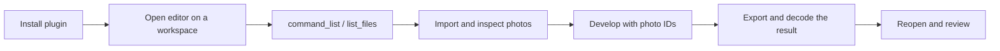

# LightCraft Use

## Plugin marketplaces

This plugin belongs to **AIGC content creation**.

| Category | Marketplace | Purpose |
| --- | --- | --- |
| Full-stack development | [Full Stack Plugins](https://github.com/partme-ai/full-stack-plugins) | Architecture and UI design, code understanding, quality checks, code review, workflow governance, and server operations |
| AIGC content creation | [Full AIGC Plugins](https://github.com/partme-ai/full-aigc-plugins) | Image, video, audio, music, 3D, and multimodal content creation |


> Cull, develop and export photographs from your agent host, with the original file preserved and every develop step kept as a reversible setting.

[](https://github.com/full-aigc-plugins/lightcraft-plugin/releases)
[](#skills)
[](#mcp-tools)
[](LICENSE)

[English](README.md) | [简体中文](README.zh-CN.md) · [Install](#installation) · [Quick start](#quick-start) · [Skills](#skills) · [Troubleshooting](#troubleshooting)

## Positioning

`lightcraft` drives the real LightCraft CLI and its browser panel from an agent host, so a photo task ends with decoded output files, a versioned develop history and a delivery receipt — not a promise that a slider moved. The plugin owns photo skills, an explicit task controller and a same-session panel bridge; it does not replace LightCraft or re-implement raw decoding.

| Property | Value |
| :--- | :--- |
| Plugin ID | `lightcraft` |
| Version | `0.1.0-dev.20261018.3` |
| Status | Development preview; production promotion blocked, creative acceptance open |
| Pinned native CLI | LightCraft CLI `0.2.1` |
| Verified platform | macOS arm64 with Python 3.11 or newer |
| Panel runtime | Node.js 24, started from `ui/bootstrap.mjs` |
| License | Apache-2.0 |

## Installation

### Prerequisites

- Node.js 24 on `PATH` for the stdio MCP server and the panel.
- Python 3.11 or newer; the skills and `scripts/controller.py` are Python entry points.
- macOS arm64 for the pinned CLI. Other platforms are tracked as independent open changes and are not claimed.
- Network access on the first panel launch; the plugin downloads and verifies the pinned editor archive, and a complete release ZIP already contains it.
- The native CLI is not bundled. The installer downloads the pinned official release and keeps the licence files inside the artifact.

### From the plugin marketplace

```bash
codex plugin marketplace add partme-ai/full-aigc-plugins
codex plugin add lightcraft@full-aigc-plugins
```

Restart the host, open a new task, and ask LightCraft to inspect a photo library before editing anything.

### Other host manifests

| Host | Manifest | Path base |
| --- | --- | --- |
| Standard Agent Plugins 1.0.0 | `plugin.json`, `mcp.json` | `${PLUGIN_ROOT}` |
| Codex | `.codex-plugin/plugin.json`, `.codex-plugin/mcp.json` | plugin root relative to `cwd` |
| Claude Code | `.claude-plugin/plugin.json`, `.mcp.json` | `${CLAUDE_PLUGIN_ROOT}` |

Kimi (`kimi.plugin.json`), DeepSeek Harness (`dsh/`) and the WorkBuddy example (`hosts/workbuddy/mcp.json`) are also present. In a development checkout you must build the editor assets first; cloning the source is not an installed runtime.

## Quick start



1. Open the panel with an explicit `workspace` argument.
2. Check the environment first: `python3 -I -B "$SKILL_DIR/scripts/bootstrap.py" --no-install` reports the pinned CLI without installing it.
3. List the real commands with `command_list`, then read a photo with `inspect` before changing it.
4. Develop with `command_run`, always binding real photo IDs; never assume a setting object from memory.
5. Export, then decode the actual output file and reopen the library in an independent session before calling the task done.

For a long task, the explicit controller records state instead of relying on the chat:

```bash
python3 -I -B scripts/controller.py init /absolute/new-task --payload /absolute/init.json
python3 -I -B scripts/controller.py run /absolute/new-task --runtime-home /absolute/runtime
python3 -I -B scripts/controller.py status /absolute/new-task
python3 -I -B scripts/controller.py deliver /absolute/new-task
```

`init`, `run`, `status`, `inspect`, `reconcile`, `stop`, `remaining`, `review-request`, `review`, `revise` and `deliver` are separate calls. `UNKNOWN` is never replayed; `reconcile` only reads.

## What you can build

| Workflow | Built-in path | Verifiable output |
| :--- | :--- | :--- |
| RAW baseline development | `lightcraft-raw-develop` | White balance, exposure, highlight and shadow settings, plus decoded output |
| Batch style across one shoot | `lightcraft-batch-photo-style` | The same look applied to the listed photos only |
| Landscape development | `lightcraft-landscape-develop` | Sky, ground and tonal separation recovered |
| Natural portrait development | `lightcraft-portrait-develop` | Skin, exposure and background balance |
| Cull and rate a library | `lightcraft-photo-culling` | Rating, grouping and a selected set |
| Final delivery | `lightcraft-photo-export` | Sized, colour-managed, named files with a receipt |
| Independent virtual copy | `lightcraft-virtual-copy-review` | A reviewable copy that leaves the original untouched |
| Named version restore | `lightcraft-named-version-restore` | Restored settings and pixels identical to the named version |
| Tone curve transfer | `lightcraft-tone-curve-transfer` | Only the curve moved; exposure, colour and crop preserved |

## Skills

| Skill | What it does |
| :--- | :--- |
| `lightcraft-use` | Main entry: route a photo request and connect the stages |
| `lightcraft-editor` | Open the editor in the host and keep agent edits on the same page |
| `lightcraft-cli` | Command catalogue, control list, JSON plan check and receipt contract |
| `lightcraft-cli-setup` | Check or install the pinned CLI, verify the version and diagnose failures |
| `lightcraft-cli-library` | Import, select and organise photos; diagnose duplicate imports |
| `lightcraft-cli-develop` | Exposure, white balance, local adjustments and scoped sync |
| `lightcraft-cli-export` | Export photos, check format, size and colour, verify delivered files |
| `lightcraft-raw-develop` | RAW baseline: white balance, exposure, highlight and shadow |
| `lightcraft-batch-photo-style` | Unify the look across one group of photos |
| `lightcraft-landscape-develop` | Sky, ground and tonal range for landscape frames |
| `lightcraft-portrait-develop` | Skin tone, exposure and background balance |
| `lightcraft-photo-culling` | Import, rate, group and select |
| `lightcraft-photo-export` | Size, colour and naming for the selected photos |
| `lightcraft-virtual-copy-review` | Review in an independent virtual copy without touching the original |
| `lightcraft-named-version-restore` | Trial a named version and restore it exactly |
| `lightcraft-tone-curve-transfer` | Migrate only the tone curve, keeping per-photo exposure and crop |
| `lightcraft-scenario-playbooks` | Highlight cleanup, black-and-white, square crop, grey-card balance, watermark review, dual-format export, contact sheet and masked fallback |

Skills are generated from the independent `lightcraft-skills` runtime and consumed here as digest-protected snapshots; `candidate-source.json` pins the published source, and `source-suite.json` records the separate native version.

## MCP tools

One bundled server, `lightcraft-editor`, speaking **stdio**. The local HTTP listener only serves the panel and its same-session bridge. The catalogue exposes 14 tools: 11 agent-callable tools and 3 `_panel_*` bridge tools the panel uses internally.

| Family | Tools | Purpose |
| :--- | :--- | :--- |
| Session | `open_editor`, `open_browser_editor`, `editor_status` | Open the panel and confirm that it attached |
| Command gateway | `command_list`, `command_run` | Discover real commands and run one with JSON params |
| Inspection | `inspect` | Inspect the visible editor or the LightCraft library |
| Library | `list_files`, `open_file` | List files held by the browser editor; import a workspace-relative file into it |
| Delivery | `save_file`, `save_project`, `screenshot` | Copy a browser file or project to a new workspace path; capture the canvas |

`save_project` does not apply to the browser photo library: the library lives in page storage, so export a backup through the `file.backupLibrary` command instead.

## Configuration

| Setting | Where | Effect |
| :--- | :--- | :--- |
| `workspace` argument | `open_editor` / `open_browser_editor` | Binds the task folder; paths outside it are refused |
| `--runtime-home` | Harness CLI and controller | Isolate the pinned runtime cache |
| `CRAFT_EDITOR_UPDATE=off` | stdio MCP `env` | Use the bundled panel only; no download attempt |
| `CRAFT_EDITOR_CACHE_DIR` | Environment | Absolute directory for verified editor archives |
| `LIGHTCRAFT_SOURCE_GIT` | CI and release preflight | Git checkout used to verify the locked skill source |

Verified archives are cached under `~/.cache/full-aigc/editors`. An active session keeps its version until closed, and a corrupt cache falls back to the bundled build.

## Architecture and security

Agent ↔ plugin traffic is stdio MCP; the browser bridge listens on `127.0.0.1` only, with a random token and Host/Origin checks. Paths outside the workspace are rejected, downloads are SHA-256 verified, and the bundled panel is always kept as a fallback.

Originals are treated as read-only inputs; edits are settings applied to a versioned history, and delivery requires a matching reopen receipt. The controller keeps a persistent task lock and atomic state, refuses to replay `UNKNOWN`, and bounds revisions. No credential is stored and no traffic reaches the authors. Details: [architecture](docs/architecture.md), [controller contract](docs/controller.zh-CN.md), [task receipts](docs/task-receipts.md), [implementation evidence](docs/verification/implementation-evidence.md).

## Troubleshooting

| Symptom | Action |
| :--- | :--- |
| Panel tools are missing | Confirm the plugin is enabled, restart the host, open a new task |
| The panel does not render inside the host | Use the URL from `open_browser_editor`; the terminal provides no browser panel |
| The CLI is reported missing or wrong | Run the setup skill's `bootstrap.py --no-install` check; it never upgrades silently |
| RAW colours look wrong after export | Review the actual decoded file in an independent session; Nikon RAW colour accuracy is still an open gate |
| The photo library disappeared | The library lives in browser storage; restore from the `file.backupLibrary` export |
| A run ends `UNKNOWN` | Reconcile read-only, then decide; never replay the step |

## Upgrade

```bash
codex plugin marketplace upgrade full-aigc-plugins
codex plugin add lightcraft@full-aigc-plugins
```

The CLI, the editor archive and the skill snapshots are pinned separately; upgrading the plugin does not silently upgrade the native CLI.

## Contributing and support

Open issues at <https://github.com/full-aigc-plugins/lightcraft-plugin/issues>. Behaviour changes start in `openspec/changes/`, and a task is checked only after real acceptance. Read `AGENTS.md` and `docs/verification/implementation-evidence.md` before claiming a capability, and keep both languages aligned.

## License

Original repository content is [Apache-2.0](LICENSE). The icon is upstream LightCraft artwork under MIT OR Apache-2.0, recorded in `assets/official-icon-source.json`. The native CLI is not redistributed; its licence files ship inside the pinned artifact. Upstream LightCraft is a separate project at <https://github.com/storytold/lightcraft>.
